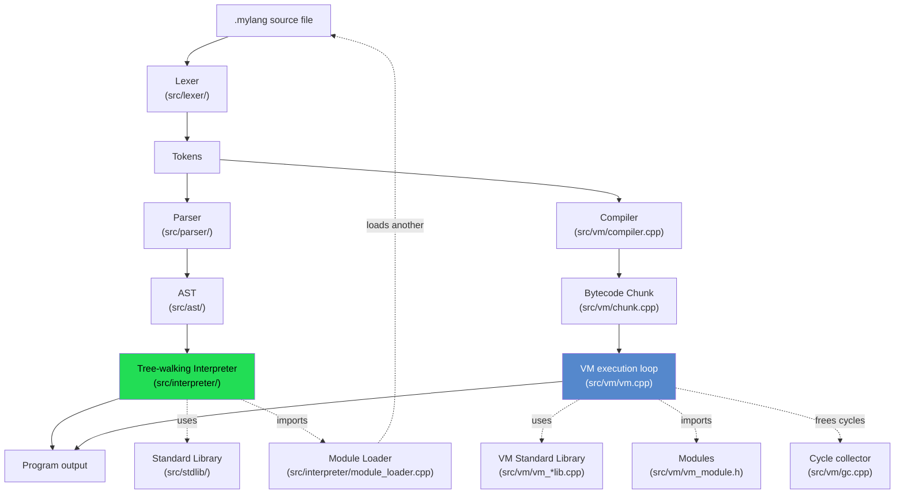

# mylang

A dynamically-typed, interpreted scripting language built from scratch
in C++, with two execution engines for the same language: a
tree-walking interpreter and a bytecode VM.

## System workflow



Two independent execution paths share the same `Lexer`/`Token` front
end, then diverge:

- **Tree-walking interpreter** (default) — the reference for the
  language's behavior: functions/closures, classes/inheritance, arrays,
  maps, imports, and the whole standard library.
  `./mylang script.mylang`
- **Bytecode VM** (`--vm` flag) — compiles to a flat instruction stream
  and runs it on a stack-based loop instead of walking the AST. It
  supports the whole language the interpreter does (closures, classes
  with inheritance, arrays, maps, imports, the standard library), and
  adds a cycle collector so reference cycles (a closure that captures
  itself, an array that contains itself) are freed. The few places where
  it differs from the interpreter are listed in `docs/vm_notes.md`.
  `./mylang --vm script.mylang`

See `docs/vm_notes.md` for why there are two engines and how the VM
works.

## Build

**With g++ directly** (Linux/macOS, or Git Bash on Windows; this compiles
every `.cpp` under `src/`, so it never goes out of date when a file is added):
```bash
g++ -std=c++17 -O2 -Isrc $(find src -name '*.cpp') -o mylang
```

**With CMake** (the way to build on Windows with MSVC):
```bash
cmake -B build
cmake --build build
```
The source files are listed explicitly in `CMakeLists.txt`: when you add a
`.cpp` file, add it there too and re-run `cmake -B build`.

## Run

**Tree-walking interpreter (default):**
```bash
./mylang path/to/script.mylang
```

**Bytecode VM:**
```bash
./mylang --vm path/to/script.mylang
./mylang --vm          # VM REPL
```

## Docs

See `docs/language_spec.md` for the language grammar/semantics (including
the list of features that are not implemented yet), and `docs/vm_notes.md`
for the bytecode VM's design, its differences from the interpreter, and its
limits.